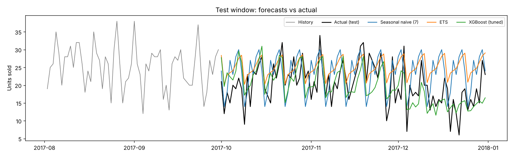
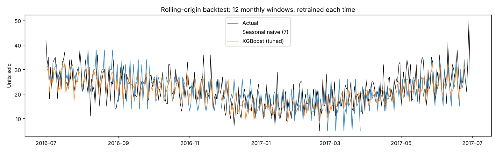
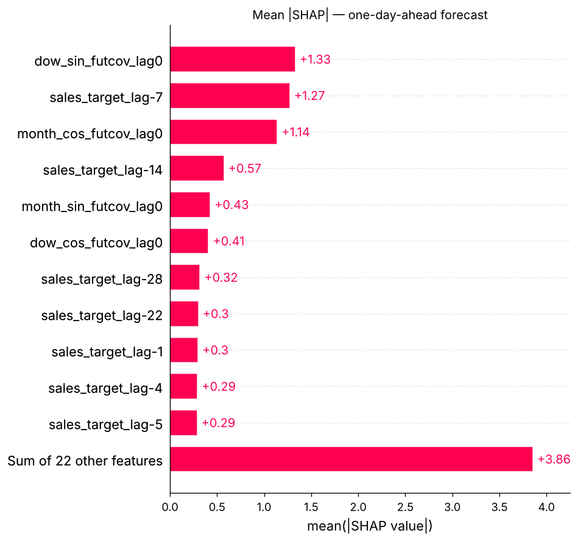

# Time Series Forecasting: Baselines, Statistical Models and XGBoost

[Live demo on Streamlit](https://iqnkddxgtwc6px7tc2l9hp.streamlit.app/)

End-to-end daily demand forecasting for one store–item series: exploratory analysis, a leakage-free train/validation/test split, a benchmark of naive, statistical and machine learning models, a rolling-origin backtest, SHAP explanations, and a Streamlit app that forecasts beyond the end of the data.

## Data

[Store Item Demand Forecasting](https://www.kaggle.com/competitions/demand-forecasting-kernels-only) (Kaggle): daily unit sales for 50 items in 10 stores, 2013-01-01 to 2017-12-31. This project models **store 1, item 1**: 1,826 daily observations with a slight upward trend, strong weekly seasonality and a yearly cycle (demand peaks in summer and drops in winter).

## Method

| Step | Detail |
| --- | --- |
| Split | Train 2013-01 → 2017-06 (1,642 days), validation 2017-07 → 2017-09 (92 days), test 2017-10 → 2017-12 (92 days) |
| Tuning | Grid search over 36 XGBoost configurations (lags, trees, depth, learning rate), scored on the **validation** window only |
| Final test | Every model refitted on train + validation and evaluated once on the test window |
| Backtest | Rolling origin, 12 windows of 30 days from 2016-07 to 2017-06, model retrained at each origin |
| Features | Lagged sales; cyclical day-of-week and month (sine/cosine) and a weekend flag as **future covariates**, since calendar features are known in advance |
| Explainability | SHAP values for the one-day-ahead forecast of the final model |

Models compared: seasonal naive (7 days), naive drift, exponential smoothing (ETS), AutoARIMA (weekly season) and XGBoost (Darts `XGBModel`).

## Results

**Held-out test window (Oct–Dec 2017, 92 days)**

| Model | MAE | MAPE | MAE vs seasonal naive |
| --- | --- | --- | --- |
| XGBoost (tuned) | 4.15 | 23.4% | −32% |
| ETS | 5.71 | 39.0% | −7% |
| AutoARIMA | 5.92 | 40.6% | −3% |
| Seasonal naive (7) | 6.12 | 38.2% | baseline |
| Naive drift | 10.40 | 68.7% | +70% |



**Rolling-origin backtest (12 × 30-day windows, Jul 2016 – Jun 2017)**

| Model | Mean MAE | Std across windows |
| --- | --- | --- |
| XGBoost (tuned) | 4.17 | 0.60 |
| ETS | 4.20 | 0.83 |
| Seasonal naive (7) | 5.18 | 0.95 |



**What drives the forecast**



## Findings

- XGBoost's large advantage on the test window comes mostly from the **month covariates**: they capture the yearly drop in demand in November–December, which weekly-seasonal models (seasonal naive, ETS, AutoARIMA) miss. SHAP ranks day-of-week, the 7-day lag and month features highest.
- Over a full year of rolling backtests, **XGBoost and ETS are essentially tied** (MAE 4.17 vs 4.20), with XGBoost more stable across windows. Both beat seasonal naive by about 20%. A single test window overstates the gain from machine learning.
- Practical takeaway: for this series, a well-specified ETS is a strong, cheap baseline; XGBoost earns its place when the forecast window crosses a seasonal turning point.

## Limitations

- One store–item series; results may not transfer to other items.
- Point forecasts only, no prediction intervals.
- No holidays, prices or promotions in the dataset.

## Project structure

```text
├── data/
│   ├── train.csv                # Kaggle data (all stores and items)
│   └── history.csv              # Store 1 / item 1 history used by the app
├── images/                      # Figures produced by the notebook
├── models/
│   └── xgb_final_model.joblib   # XGBoost refitted on the full history
├── time_series_analysis.ipynb   # Analysis, tuning, benchmark, backtest, SHAP
├── utils.py                     # Data loading, covariates, model factory, evaluation, grid search
├── app.py                       # Streamlit app: forecasts from 2018-01-01 onwards
└── requirements.txt
```

## Run locally

```bash
pip install -r requirements.txt
jupyter nbconvert --to notebook --execute time_series_analysis.ipynb   # rebuilds model, figures and history.csv
streamlit run app.py
```
